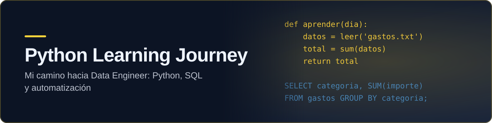
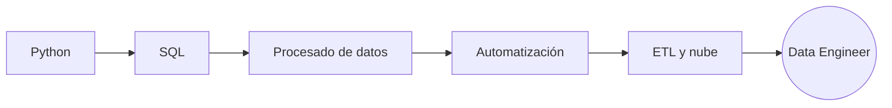

  
  
  
  
  

# David Lopes

Future Data Engineer focused on Python, SQL, automation and data processing.

Currently learning from scratch and building projects publicly to document my progress.

---

# About Me

I am currently learning:

- Python programming
- SQL
- Data processing
- File automation
- Basic data analysis
- Git & GitHub

My goal is to become a Data Engineer and work on real-world data systems and automation projects.

---

# Technologies & Tools

## Learning
- Python
- SQL
- Git
- GitHub
- Pandas
- File Processing
- Data Cleaning

## Future Goals
- Cloud Computing
- Apache Spark
- ETL Pipelines
- Big Data
- APIs
- Data Warehousing

---

# Current Python Topics

- Variables
- Loops
- Functions
- Lists
- Dictionaries
- Tuples
- Conditionals
- File handling
- Reading TXT files
- Email parsing exercises
- Data counting with dictionaries

---

# SQL Topics

- SELECT
- WHERE
- ORDER BY
- LIMIT
- DISTINCT
- GROUP BY
- HAVING
- INSERT
- UPDATE
- DELETE
- JOINs
- Subqueries

---

# Current Projects

## Smart Expense Reader
A project focused on reading TXT/PDF files and extracting expense information automatically.

Goals:
- Read files automatically
- Process information
- Search expenses
- Automate repetitive tasks

---

# Learning Philosophy

I believe in learning publicly by building projects consistently and improving step by step.

This GitHub is my journey from beginner to professional Data Engineer.
